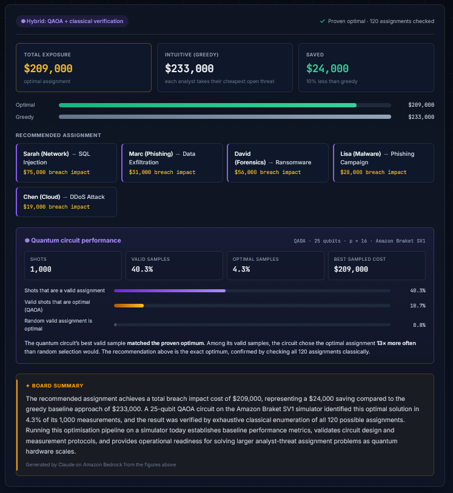
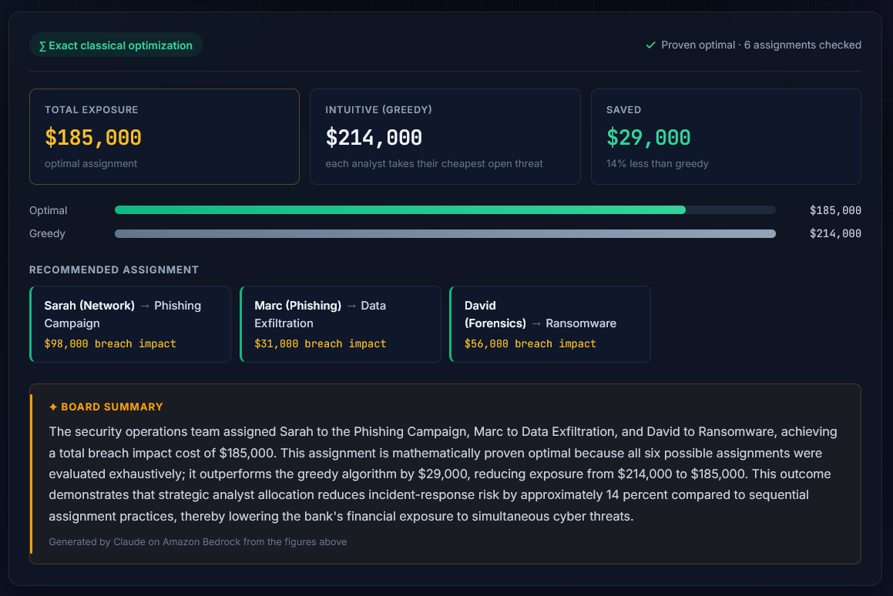

# Explain This Project to Me (101)

**A 5-minute read for managers, recruiters and anyone curious. No technical background needed.**

> Want the full story with all the screenshots? Read the [README](./README.md).
> Want to rebuild it yourself? Read [SETUP.md](./SETUP.md).

---

## The story in 30 seconds

It's 2 a.m. at a bank. **Five cyberattacks hit at the same time.** Five security analysts are on duty, and each one is faster on some attacks than others.

Every minute an attack goes unhandled, the bank loses money. The manager has to decide quickly: **who handles which attack?**

This project is a website that answers that question. It finds the plan that **loses the least money**, proves it is the best possible plan, and writes a short summary a CEO can read. It also hands the same problem to a **quantum computer simulator** to test how well this new technology does on a real business decision.

  

---

## Why is this hard? Isn't it obvious?

Most people solve it the natural way: give each analyst the attack they are best at, one after another.

That sounds smart, but it often fails. The first person picks their favourite, which leaves a bad option for the last person. In the project's example:

| Approach | Money at risk |
|---|---:|
| "Everyone picks their best" (the natural way) | $233,000 |
| **The best possible plan (found by this project)** | **$209,000** |
| **Saved** | **$24,000** |

The trick: one analyst takes an attack that looks worse for them, which frees a much better match for a teammate. **What matters is the team total, not each person's choice.** People under pressure tend to miss that kind of trade-off.

And it gets harder fast. With 5 people there are 120 possible plans. With 20 people there are more than **2 billion billion**. Problems that grow this fast are where quantum computers might help one day.

---

## What happens when you use it

1. **Open the website** and choose a team size (from 2×2 up to 5×5).
2. **Fill in the table:** how much each analyst would cost on each attack. Colors show cheap (green) and expensive (red) at a glance.
3. **Click "Optimize".**
4. **Get the answer:**
   - who handles what,
   - the total money at risk,
   - how much was saved compared with the natural approach,
   - a plain-English **summary for the board**, written by AI.

Small teams get the answer in about 2 seconds. A 5×5 team also goes to the quantum simulator and takes about 45 seconds, with a progress tracker on screen.

  

---

## The three "buzzword" technologies, made simple

### 1. Quantum computing

A normal computer tries possibilities one after another. A quantum computer uses the strange rules of physics to work with many possibilities **at once**, then "nudges" itself toward the good ones.

In this project, the problem is translated into a **quantum program** (an algorithm called QAOA) and run on Amazon's quantum simulator, which uses **25 qubits**, the quantum version of bits.

**The honest result:** quantum computers are still young and "noisy". Run on its own, the quantum program doesn't pick the perfect plan every time. But it **found the best plan in every test run**, and among the sensible answers it returned, the best plan came up about **13 times more often than random guessing** would produce. The project reports this openly instead of overselling it. That honesty is part of the point.

### 2. Artificial Intelligence (AI)

Numbers alone don't convince executives. So the system sends the results to **Claude** (an AI model from Anthropic, used through Amazon's Bedrock service), which writes a short, clear summary for the board.

Important design choice: **the AI never makes the decision.** The math picks the plan, and the AI only explains it. If the AI service is down, a ready-made summary is used instead, so the app always works.

### 3. The cloud (AWS)

Everything runs on **Amazon Web Services**, the world's largest cloud platform. There are no servers to manage. The system wakes up only when someone uses it and costs **almost nothing when idle**. The full test session for this project cost about **$0.10**.

The whole setup is written as code (with a tool called **Terraform**), so it can be rebuilt from scratch, identically, with a single command.

---

## Why a manager should care

| What it shows | Why it matters |
|---|---|
| **Better decisions under pressure** | Turns a gut call into a provably optimal plan, saving money in a crisis. |
| **Explainable results** | Executives get a plain-English summary, not a spreadsheet. |
| **Responsible innovation** | Explores quantum computing honestly, measuring what works today instead of hype. |
| **Low cost** | Pay only when it's used: cents per session, about $0 when idle. |
| **Security first** | Built with strict access rules, usage limits and protections against misuse. |
| **Reliable** | 48 automated tests check the system every time the code changes. |

---

## What makes this project stand out

- **It's real.** It was deployed on AWS and tested live, with screenshots of every part in the [README](./README.md#7-proof-it-really-runs).
- **It's honest.** Every answer is checked against the proven best, and quantum's limits are stated plainly.
- **It's complete.** Website, cloud backend, quantum algorithm, AI, security, monitoring and automated testing, built end to end.
- **It's explainable.** It can be described to a CEO, and the code is commented for engineers.

---

## Mini glossary

| Word | Meaning in one line |
|---|---|
| **SOC** | Security Operations Center: the team that defends a company against cyberattacks. |
| **Optimization** | Finding the best option among many possibilities. |
| **Qubit** | The quantum version of a bit. It can hold a mix of 0 and 1 at the same time. |
| **QAOA** | The quantum algorithm used here to search for good plans. |
| **Simulator** | A powerful normal computer that imitates a quantum computer exactly. |
| **AWS** | Amazon Web Services, Amazon's cloud platform. |
| **Serverless** | Code that runs only when needed, with no machine kept running. |
| **Terraform** | A tool that builds cloud infrastructure from code files. |
| **Claude / Bedrock** | The AI model that writes the summary, and the Amazon service that provides it. |

---

**In short:** this project takes a stressful, high-stakes decision, solves it perfectly, explains it simply, and uses it to test one of the most talked-about technologies of the decade, honestly.
