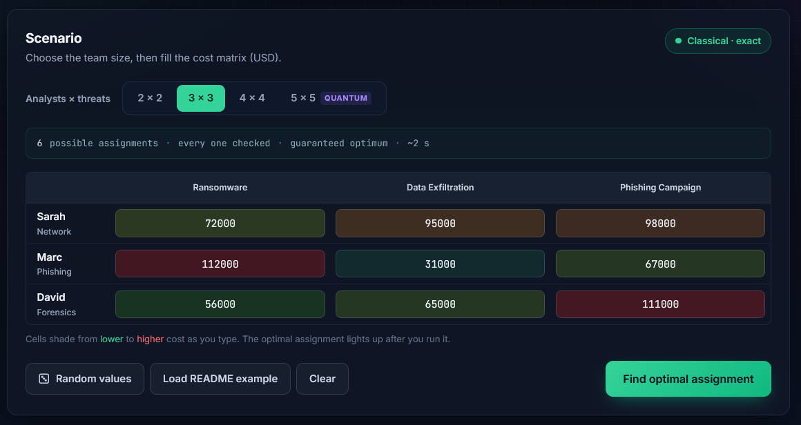
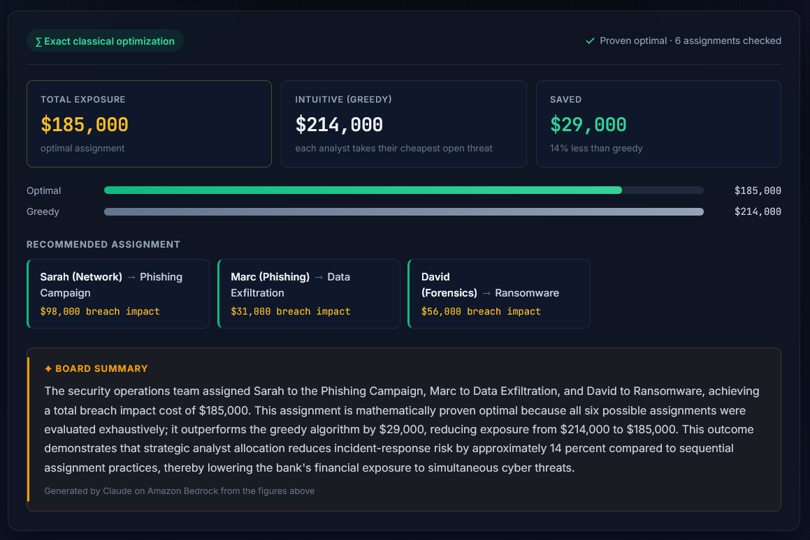
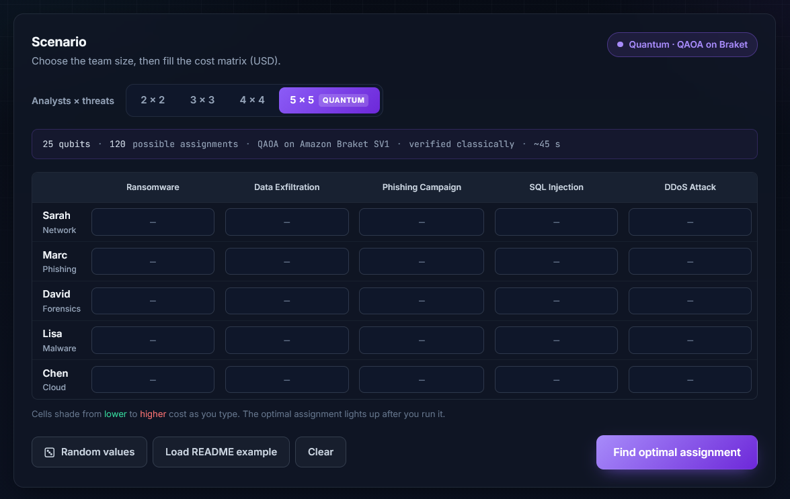
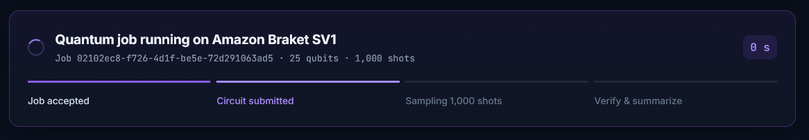
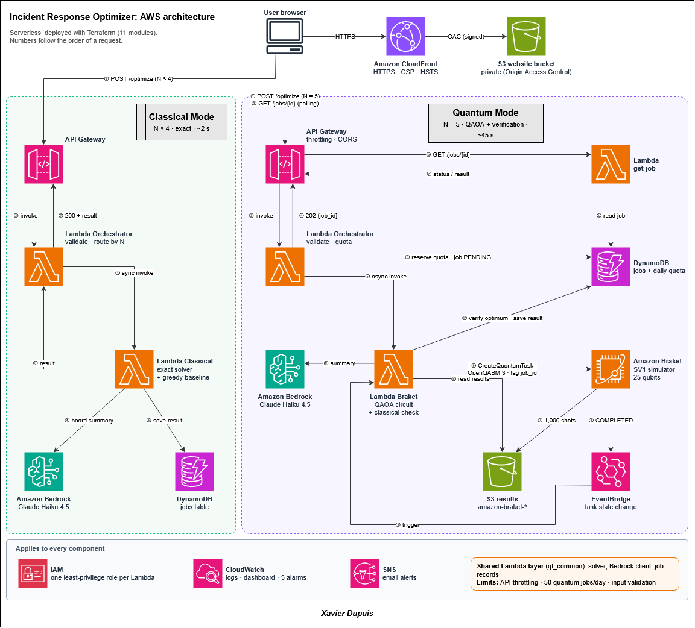
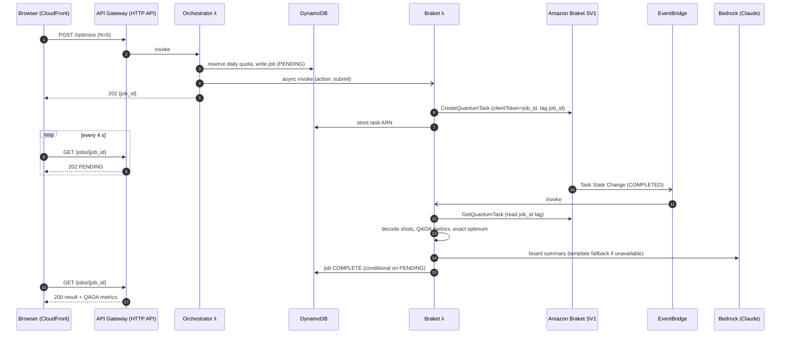

# Quantum-Ready Incident Response Optimization on AWS
### Assign the right analyst to the right threat

[](https://github.com/Xav519/aws-quantum-finance-AI/actions/workflows/ci.yml)
[](https://aws.amazon.com)
[](https://www.terraform.io)
[](https://python.org)
[](https://aws.amazon.com/braket)
[](https://aws.amazon.com/bedrock)

> When a bank is hit by several cyberattacks at once, this system tells the security manager **which analyst should handle which attack** to lose the least money. It proves the answer is the best possible one and explains it in plain English for executives. It also runs the same problem on a **quantum computing service** and reports, transparently, how well the quantum algorithm did.

**Jump to:** [In 30 seconds](#in-30-seconds) · [What this project demonstrates](#what-this-project-demonstrates) · [Demo](#live-demo) · [How it works](#how-it-works) · [Technical deep dive](#technical-deep-dive) · [Run it yourself](#run-it-yourself) · [Limitations](#honest-limitations-and-roadmap)

---

## In 30 seconds

**The problem.** A bank faces five simultaneous incidents (ransomware, data theft, phishing, and so on) and has five analysts. Each analyst is faster on some threats than others, and every hour an attack stays open costs money. Picking assignments on gut feeling leaves money on the table.

**The solution.** The manager enters what each analyst would cost on each threat. The system:

1. finds the assignment with the **lowest total cost** and proves no better one exists,
2. shows how much that saves compared with an "intuitive" assignment,
3. writes a three-sentence summary a board member can read.

**A real example** (each cell is the breach impact in dollars if that analyst handles that threat):

```
           Ransomware  Data Theft  Phishing  SQL Injection   DDoS
Sarah       $72,000     $95,000     $98,000     $75,000     $37,000    → SQL Injection
Marc       $112,000     $31,000     $67,000     $99,000     $49,000    → Data Theft
David       $56,000     $65,000    $111,000    $106,000     $34,000    → Ransomware
Lisa        $61,000    $120,000     $28,000     $77,000    $115,000    → Phishing
Chen       $107,000    $101,000     $10,000     $81,000     $19,000    → DDoS

Intuitive assignment (each analyst in turn picks their cheapest open threat):   $233,000
Optimal assignment found by the system:                                         $209,000
Saved:                                                                           $24,000
```

The result is counter-intuitive: Sarah's cheapest threat is DDoS ($37k), but the team does better with Sarah on SQL Injection and Chen on DDoS.

**Where quantum fits.** For five analysts, a normal computer solves this instantly. The project also sends the problem to **Amazon Braket** (AWS's quantum computing service) as a 25-qubit quantum program, then checks the quantum answer against the proven best one. That gives an honest measurement of a quantum algorithm on a real business problem, and a ready pipeline for harder problems where quantum methods may eventually help. **It does not claim quantum is faster today.**

---

## What this project demonstrates

| Skill | Evidence in this repository |
|---|---|
| **Cloud architecture (AWS)** | Serverless system across 9 AWS services: API Gateway, Lambda, DynamoDB, EventBridge, S3, CloudFront, Braket, Bedrock, CloudWatch |
| **Security engineering** | Least-privilege IAM role per function, strict input validation, rate limiting and a daily cost cap, HTTPS-only private website with a Content-Security-Policy, prompt-injection-aware AI prompts ([details](#security-and-cost-controls)) |
| **Infrastructure as Code** | Entire stack in Terraform (11 modules), deployable and destroyable with one command, including safe state migrations |
| **Quantum computing** | Problem translated into a QUBO/Ising model, QAOA circuit implemented from scratch, verified with a purpose-built simulator before spending on cloud quantum time |
| **Applied AI** | Claude on Amazon Bedrock writes executive summaries limited to the computed figures, with a fallback when the AI service is unavailable |
| **Reliability engineering** | Asynchronous workflow with idempotency (no duplicate billed jobs), safe retries, clear failure states, alarms |
| **Software quality** | 48 automated tests, CI on every push, an offline benchmark that reproduces the published numbers |
| **Communication** | Results explained for executives (AI summary), recruiters and engineers (this README) |

---

## Live demo

The website is served by CloudFront (the `demo_url` output after deployment). To deploy your own copy and reproduce the results below, follow **[SETUP.md](SETUP.md)**.

**1. Pick a team size and enter or generate costs**

<p align="center"></p>

**2. Small teams (up to 4×4): exact answer in about 2 seconds**

<p align="center"></p>
<p align="center"></p>

**3. 5×5 teams: a 25-qubit quantum job runs on Amazon Braket (about 45 seconds)**

<p align="center"></p>
<p align="center"></p>
<p align="center"></p>

---

## How it works

### The simple version

```
 Manager's browser
       │  "Here are my analysts, threats and costs"
       ▼
 API (rate-limited, validated)
       │
       ├── 2 to 4 analysts ──► check every possible assignment ──► best answer + AI summary   (≈2 s)
       │
       └── 5 analysts ───────► quantum program on Amazon Braket ─┐
                               (runs in the background)          │
                                                                 ▼
                               decode quantum results, verify against the proven best answer,
                               AI summary, store result ──► browser picks it up   (≈45 s)
```

### The architecture

<p align="center"></p>

### Glossary for non-specialists

| Term | Meaning here |
|---|---|
| **Qubit** | The basic unit of a quantum computer. This problem uses 25 qubits, one per analyst-threat pair |
| **QAOA** | *Quantum Approximate Optimization Algorithm*, a well-known quantum method for finding low-cost solutions |
| **Amazon Braket** | AWS's quantum computing service. This project uses its SV1 simulator, which reproduces an ideal quantum computer exactly |
| **Amazon Bedrock / Claude** | AWS's service for AI models; Claude writes the executive summary |
| **Serverless / Lambda** | Code that runs on demand without managing servers; costs nothing when idle |
| **Terraform** | A tool that creates the whole cloud environment from code, reproducibly |

---

## Technical deep dive

- [Request flow](#request-flow)
- [Classical and quantum paths](#classical-and-quantum-paths)
- [The QAOA formulation](#the-qaoa-formulation)
- [QAOA performance](#qaoa-performance)
- [Hybrid verification](#hybrid-verification)
- [Security and cost controls](#security-and-cost-controls)
- [Infrastructure as Code](#infrastructure-as-code)
- [Testing](#testing)
- [API reference](#api-reference)

### Request flow



### Classical and quantum paths

| | Classical (N ≤ 4) | Quantum (N = 5) |
|---|---|---|
| Method | Enumerate all N! permutations (≤ 24) | QAOA, 25 qubits, p = 16 layers, 5,625 gates, 1,000 shots on Braket SV1 |
| Response | Synchronous `200` | `202` + `job_id`, then poll `GET /jobs/{job_id}` |
| Result | Proven optimum + greedy baseline + summary | Proven optimum + greedy baseline + **QAOA quality metrics** + summary |

The plain assignment problem is easy classically: the Hungarian algorithm solves N = 50 in milliseconds. N = 5 is chosen because every quantum result can be verified exactly, which is how you build trust in a quantum pipeline.

### The QAOA formulation

All quantum logic is in [`modules/lambda_braket/src/qaoa.py`](modules/lambda_braket/src/qaoa.py) (pure Python, no dependencies).

**1. Problem → QUBO.** One binary variable `x_ij` per (analyst *i*, threat *j*) gives N² qubits. The constraints become quadratic penalties:

```
E(x) = Σ c'_ij x_ij                 cost, normalised to [0, 1]
     + A Σ_i (Σ_j x_ij − 1)²        each analyst takes exactly one threat
     + A Σ_j (Σ_i x_ij − 1)²        each threat gets exactly one analyst
```

Dropping one assignment from a valid permutation saves at most `c'_max = 1` but breaks one row and one column (+2A), so any `A > 0.5` favours valid assignments. The code uses `A = 0.75`. A test checks, over all 2⁹ states, that the QUBO's ground state is the optimal assignment.

**2. QUBO → Ising.** Substituting `x = (1 − z)/2` gives `H_C = Σ h_k Z_k + Σ J_kl Z_k Z_l`, rescaled so the largest coefficient is 1. The angle schedule is then independent of problem size and dollar amounts.

**3. Circuit (OpenQASM 3, Braket dialect).**

```
|+⟩^⊗25  ──►  for i = 1..p:  e^{−iγᵢ H_C} · e^{−iβᵢ H_M}  ──►  measure (1,000 shots)

  e^{−iγ h Z_k}         →  Rz(2γh)                          each qubit
  e^{−iγ J Z_k Z_l}     →  CNOT(k,l) · Rz_l(2γJ) · CNOT(k,l) each same-row / same-column pair (100 per layer)
  e^{−iβ H_M}, H_M=−ΣX  →  Rx(−2β)                           each qubit
```

**4. Linear-ramp schedule, no variational loop.** Textbook QAOA tunes (γ, β) in an optimization loop, but on Braket every iteration is a separately billed task. This project uses a fixed, annealing-inspired linear ramp (Montañez-Barrera & Michielsen, *Towards a universal QAOA protocol*, 2024): γ ramps up as β ramps down. Δγ = 3.2, Δβ = 0.6, A and p were tuned offline with the local simulator, then frozen.

**5. Decoding.** A bitstring is valid if every row and column has exactly one `1`. The handler reports the best valid sample, the share of valid shots and the share of optimal shots. Invalid samples are never "repaired" into answers.

### QAOA performance

Noiseless statevector simulation of the exact circuit the Lambda submits (`python tests/benchmark_qaoa.py`), random cost matrices ($10k-$120k), 1,000 sampled shots:

| N | Qubits | Instances | P(valid) per shot | P(optimal) per shot | Random guess P(optimal) | Best sample = optimum |
|---|--------|-----------|-------------------|---------------------|-------------------------|-----------------------|
| 3 | 9      | 20        | 0.665             | 0.323               | 2.0 × 10⁻³              | 20 / 20               |
| 4 | 16     | 20        | 0.710             | 0.139               | 1.5 × 10⁻⁵              | 20 / 20               |
| 5 | 25     | 5         | 0.433             | 0.049               | 3.0 × 10⁻⁸              | 5 / 5                 |

At N = 5 the circuit makes the optimal assignment more than a million times more likely than random sampling of 25 qubits. About 49 of 1,000 shots are optimal, and the optimum was found in every run. SV1 is noiseless, so live results match these statistics up to sampling variation; [SETUP.md](SETUP.md#5-reproduce-the-results) lists the expected live values for the example above.

> **History:** the first version used a fixed 1-3 layer circuit with an incomplete constraint encoding and always returned the brute-force answer. Its QAOA gaps were 33-112%. Reformulating as a proper QUBO with a tuned schedule produced the table above.

### Hybrid verification

```
QAOA samples → best valid sample measured → exact optimum computed classically → optimum returned
```

At N = 5, checking all 120 assignments is instant, so the system can be fully transparent: the **verified optimum** is the recommendation, and the QAOA metrics are returned alongside it and shown in the UI. For problems too large to verify exhaustively, the same metrics (valid-shot rate, best sampled cost) are what you would monitor.

### Security and cost controls

A public demo that triggers paid services is a denial-of-wallet target. Controls, from the edge in:

| Layer | Control |
|---|---|
| **Frontend** | Private S3 bucket behind CloudFront with **Origin Access Control**; HTTPS only; HSTS, `X-Frame-Options: DENY`, `nosniff`, strict **CSP** (`script-src 'self'`, no inline script); all API data HTML-escaped |
| **API Gateway** | Throttling (10 rps / 20 burst; `POST /optimize` 1 rps / 5 burst); **CORS restricted** to the CloudFront origin; structured access logs |
| **Orchestrator** | Strict validation (size, types, finite non-negative costs, label allow-list, 16 KB body); **daily quantum-job quota** enforced atomically in DynamoDB (`429` when exhausted) |
| **IAM** | **One role per Lambda**, each statement scoped to a concrete ARN (table, bucket, the two invokable functions, its own log group, the configured Bedrock model). `get_job` can only `GetItem` |
| **Invocation** | API Gateway can invoke only its routes; EventBridge only from its rule; Braket events from other projects are ignored |
| **Data** | Encryption at rest; S3 denies non-TLS requests, ACLs disabled; Braket results expire after 30 days, job records after 7 |
| **AI** | User-supplied names are validated, wrapped in `<data>` tags and declared non-instructions in the system prompt; the model is told to use only the provided figures and never claim a quantum advantage; output rendered as text |
| **Monitoring** | Error alarms on all four Lambdas and on API 5xx, delivered by SNS email |

### Infrastructure as Code

```
rootTerraformCode/          root module, variables, outputs, state moves
modules/
├── storage/                DynamoDB jobs table, Braket results bucket
├── iam/                    4 least-privilege execution roles
├── shared_layer/           Lambda layer: qf_common (solver, Bedrock, job records, HTTP)
├── lambda_orchestrator/    POST /optimize: validation, quota, routing
├── lambda_classical/       exact solver + greedy baseline + summary
├── lambda_braket/          QAOA submit + completion (qaoa.py)
├── lambda_get_job/         GET /jobs/{job_id}
├── messaging/              EventBridge: Braket task state change → Lambda
├── api_gateway/            HTTP API, throttling, CORS, access logs
├── demo_frontend/          private S3 + CloudFront + security headers; site/ is static
└── observability/          SNS, alarms, dashboard
```

<details>
<summary><b>Key design decisions</b></summary>

| Decision | Rationale |
|---|---|
| Orchestrator writes `PENDING` **before** dispatching | An accepted job can never 404, even if a later step fails |
| `clientToken = job_id` on `CreateQuantumTask` | Retries cannot create duplicate billed quantum tasks |
| Job ID carried as a **Braket task tag** | Completion handler resolves its job from the task: no race, no secondary index, foreign tasks ignored |
| State transitions conditional on `status = PENDING` | Duplicate events and retries are harmless |
| Errors mark the job `FAILED`, then re-raise | User sees a clear failure *and* the alarm fires |
| Bedrock summary has a deterministic fallback | An AI outage never loses a result; `narrative_source` says which was used |
| Linear-ramp QAOA instead of a variational loop | Each optimizer step would be a separate billed task |
| OpenQASM 3 with Braket's built-in gate names, no `include` | The only format SV1 accepts today; the program follows SV1's published constraints (one register each, all qubits measured) and is checked by a test that parses and simulates the exact source |
| Shared code as a **Lambda layer** | Defined once instead of copy-pasted per function |
| arm64, pure Python | Cheaper, faster cold starts, nothing to compile |
| Log groups created before each function; `moved` blocks | Retention from the first invocation; existing deployments migrate without recreation |

</details>

### Testing

```bash
pip install -r requirements-dev.txt
pytest                                               # 48 tests, ~1 s
python tests/benchmark_qaoa.py                       # performance table, N = 3 and 4
python tests/benchmark_qaoa.py --n 5 --instances 5   # 25 qubits, ~3 min per instance
```

| Suite | What it proves |
|---|---|
| `test_qaoa.py` | QUBO ground state = optimal assignment; Ising ≡ QUBO up to a constant; **the exact OpenQASM program sent to Braket, parsed and simulated gate by gate, equals the reference QAOA evolution**; the optimum is the most likely outcome; decoding and metrics |
| `test_handlers.py` | End-to-end quantum flow with in-memory AWS fakes: 202 → idempotent submit → completion (duplicate event ignored) → 200; failed and foreign tasks; daily quota; ID validation |
| `test_validation.py` | Malformed, oversized, non-finite, duplicate and injection-style inputs are rejected |
| `test_common.py` | The README example values, Bedrock fallback paths, DynamoDB/JSON serialization |

GitHub Actions runs the tests plus `terraform fmt -check` and `terraform validate` on every push. `tests/statevector.py` is a small numpy statevector simulator written for this project.

### API reference

<details>
<summary><b><code>POST /optimize</code></b></summary>

```json
{
  "analysts":    ["Sarah", "Marc", "David", "Lisa", "Chen"],
  "alerts":      ["Ransomware", "Data Exfiltration", "Phishing", "SQL Injection", "DDoS"],
  "cost_matrix": [
    [72000,  95000,  98000,  75000,  37000],
    [112000, 31000,  67000,  99000,  49000],
    [56000,  65000, 111000, 106000,  34000],
    [61000, 120000,  28000,  77000, 115000],
    [107000, 101000, 10000,  81000,  19000]
  ]
}
```

Rules: 2 ≤ N ≤ 5; all three fields size N (×N); names unique, 1-60 characters (letters, digits, spaces, `. , ' ( ) & / + -`); costs between 0 and 1,000,000,000.

| Status | Meaning |
|---|---|
| `200` | N ≤ 4: completed classical result |
| `202` | N = 5: quantum job accepted; poll `GET /jobs/{job_id}` |
| `400` | Validation error: `{"error": "..."}` |
| `429` | Rate limit or daily quantum quota reached |
| `502` | A downstream solver could not be reached |

Classical `200` (the top-left 3×3 of the example):
```json
{
  "job_id": "uuid", "status": "COMPLETE", "method": "CLASSICAL",
  "assignment": [
    {"analyst": "Sarah", "alert": "Phishing", "cost": 98000},
    {"analyst": "Marc", "alert": "Data Exfiltration", "cost": 31000},
    {"analyst": "David", "alert": "Ransomware", "cost": 56000}
  ],
  "total_cost": 185000, "greedy_cost": 214000, "savings": 29000,
  "combinations_evaluated": 6,
  "narrative": "Three-sentence board summary...", "narrative_source": "bedrock"
}
```

Quantum `202`:
```json
{ "job_id": "uuid", "status": "PENDING", "method": "QUANTUM", "qubits": 25, "shots": 1000,
  "message": "QAOA circuit (25 qubits, 1,000 shots) queued for Amazon Braket SV1." }
```
</details>

<details>
<summary><b><code>GET /jobs/{job_id}</code></b></summary>

| Status | Body |
|---|---|
| `202` | `{"status": "PENDING", "message": "..."}` |
| `200` | `COMPLETE` result, or `{"status": "FAILED", "error": "..."}` |
| `400` / `404` | Not a UUID / unknown or expired job |

A completed quantum job adds a `qaoa` object (values vary slightly from run to run because measurement is random):

```json
"qaoa": {
  "qubits": 25, "layers": 16, "shots": 1000,
  "feasible_fraction": 0.391, "optimal_fraction": 0.041,
  "qaoa_assignment": [{"analyst": "Sarah", "alert": "SQL Injection", "cost": 75000}],
  "qaoa_cost": 209000, "qaoa_gap_pct": 0.0, "qaoa_found_optimum": true,
  "distinct_bitstrings": 494, "random_baseline_optimal_fraction": 0.0083
}
```
</details>

---

## Run it yourself

```bash
git clone https://github.com/Xav519/aws-quantum-finance-AI.git
cd aws-quantum-finance-AI/rootTerraformCode
cp terraform.tfvars.example terraform.tfvars   # add your email
terraform init && terraform apply
```

That is the short version. **[SETUP.md](SETUP.md)** covers the one-time AWS account preparation (Braket, Bedrock model access), verification steps, the exact inputs and expected outputs to reproduce these results live, costs, troubleshooting and teardown.

---

## Honest limitations and roadmap

**Limitations**
- **No quantum advantage.** Classical algorithms solve this problem faster at every size; the quantum path is a validated pipeline, not a speed-up.
- **Simulator, not hardware.** SV1 is noiseless. With about 3,200 two-qubit gates, this circuit is far too deep for today's noisy quantum processors.
- **Demo-grade access control.** The API is public, protected by throttling and a quota rather than authentication.

**Roadmap**
- **Real QPU execution:** device-specific parameters, a constraint-preserving XY-mixer formulation, shallower circuits and error mitigation (changing the device ARN alone is not enough).
- **Variational tuning** with Amazon Braket Hybrid Jobs, compared against the fixed schedule.
- **Larger classical N** with the Hungarian algorithm (`scipy.optimize.linear_sum_assignment`).
- **Authentication** (Cognito) and AWS WAF for non-demo use.
- **Constrained variants** (analysts on several incidents, skills, SLAs), which are NP-hard and where the QUBO approach actually matters.

---

## Engineering challenges solved

<details>
<summary><b>Braket and Bedrock integration (9 issues)</b></summary>

| # | Issue | Root cause | Fix |
|---|---|---|---|
| 1 | `ValidationException: include statements not supported` | OpenQASM 3.0 `include "stdgates.inc"` rejected by SV1 | Moved to JAQCD JSON IR (later back to OpenQASM without `include`, see #24) |
| 2 | `ValidationException: cx gate not supported` | `cx` comes from `stdgates.inc`; Braket's built-in name is `cnot` | Use Braket gate names (`cnot`, `rz`, `rx`, `h`) |
| 3 | `Provided action is not valid` | JAQCD gates used `"gate"`; the field is `"type"` | Verified against `amazon-braket-schemas-python` |
| 4 | `results field invalid` | Measurement is implicit in JAQCD | `results: []` |
| 5 | `paradigmParameters is missing` | `CreateQuantumTask` needs `deviceParameters` | Added simulator device parameters with `qubitCount` |
| 6 | `bucket must start with 'amazon-braket-'` | Braket naming rule | Bucket renamed |
| 7 | `ResourceNotFoundException` on `InvokeModel` | Anthropic models need a use-case form on new accounts | Submitted form; `us.` inference profile |
| 8 | `JSONDecodeError` after async invoke | `InvocationType="Event"` returns no payload | Removed the payload read |
| 9 | `qubitCount must be between 1 and 34` | N = 6 needs 36 qubits | Max N = 5 |

</details>

<details>
<summary><b>Infrastructure (5 issues)</b></summary>

| # | Issue | Fix |
|---|---|---|
| 10 | Dashboard `region required` | `region` on every widget |
| 11 | Output referenced a non-existent EventBridge resource | Fixed reference |
| 12 | Completion handler scanned the table to find its job | GSI first, then replaced by a Braket task tag (no index, no race) |
| 13 | `templatefile()` broke on JavaScript `${...}` | Static site files plus a generated `config.js` |
| 14 | `AWSServiceRoleForAmazonBraket` missing | One-time console step |

</details>

<details>
<summary><b>Second iteration: hardening review and redeployment (11 findings)</b></summary>

| # | Finding | Fix |
|---|---|---|
| 15 | QAOA penalty missing linear terms; fixed angles | Full QUBO → Ising derivation, tuned schedule, tests + simulation |
| 16 | Quantum result discarded; invalid samples repaired greedily | Best valid sample reported with valid/optimal shot rates |
| 17 | AI summary claimed superposition "evaluated every configuration" | Prompts limited to supplied figures; no advantage claims |
| 18 | Public API could trigger unlimited paid calls | Throttling, daily quota, CORS lock-down |
| 19 | Jobs could stay `PENDING` forever | PENDING written first, failures mark `FAILED`, AI fallback |
| 20 | Retries could duplicate quantum tasks | `clientToken` + conditional transitions |
| 21 | Shared IAM role with wildcard resources | One scoped role per function |
| 22 | `innerHTML` with API data; public HTTP bucket | Escaping, CSP, CloudFront + OAC |
| 23 | No tests | 48 tests, CI, benchmark |
| 24 | Redeploy: `Device ... sv1 supports ['braket.ir.openqasm.program'] action type, but the supplied action type is braket.ir.jaqcd.program` | SV1 dropped JAQCD since the first version. Queried `GetDevice` capabilities and re-emitted the same circuit as OpenQASM 3 within SV1's constraints; the test now simulates the exact OpenQASM text |
| 25 | Redeploy: `Runtime.ImportModuleError: No module named 'qf_common'` | `archive_file` zips the *contents* of `source_dir`, so the layer lacked the `python/` prefix Lambda requires. Moved code to `layer/python/` and added a layout test |

</details>

---

## Technical stack

| Area | Tools |
|---|---|
| **AWS** | Braket (SV1), Bedrock (Claude Haiku 4.5), Lambda (Python 3.12, arm64, shared layer), API Gateway HTTP API, DynamoDB, EventBridge, S3, CloudFront, CloudWatch, SNS, IAM |
| **IaC** | Terraform, 11 modules |
| **Algorithms** | QAOA (QUBO/Ising, linear-ramp, p = 16), exact enumeration, greedy baseline |
| **Dev** | pytest, numpy (simulator and benchmark only), GitHub Actions |

---

## About

**Xavier Dupuis**
Cybersecurity Advisor - Banque Nationale du Canada
B.Eng. Cybersecurity Engineering - École Polytechnique de Montréal (Graduating 2026)

**Certifications:** AWS Certified Security Specialty · AWS Solutions Architect Associate · AWS Cloud Practitioner · CompTIA Security+ · CompTIA Network+

<p align="center">
  <b>Let's build something secure.</b><br>
  <a href="https://www.linkedin.com/in/xavierdupuis/">LinkedIn</a>
</p>
