# Quantum-Ready Incident Response Optimization on AWS
### Assign the right analyst to the right threat

[](https://github.com/Xav519/aws-quantum-finance-AI/actions/workflows/ci.yml)
[](https://aws.amazon.com)
[](https://www.terraform.io)
[](https://python.org)
[](https://aws.amazon.com/braket)
[](https://aws.amazon.com/bedrock)

<p align="center">
  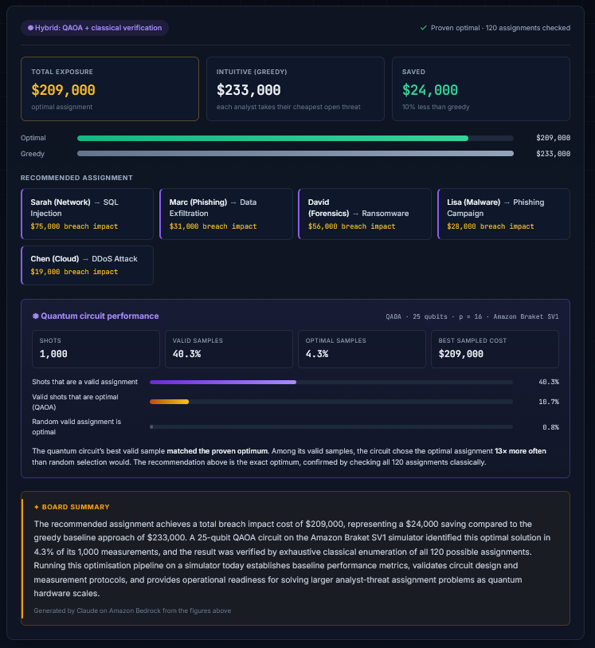
</p>

> **In one sentence:** when a bank is hit by several cyberattacks at once, this web application tells the security manager **which analyst should handle which attack** so the bank loses as little money as possible. It **proves** the answer is the best one, explains it in plain English for executives, and also solves the problem on a **quantum computer simulator** to measure, honestly, how well quantum algorithms do on a real business problem.

**You don't need to know anything about quantum computing, AI or AWS to read this.** Each idea is explained from scratch. Engineers can jump straight to the [technical deep dive](#technical-deep-dive).

---

## Contents

1. [The problem: who handles what?](#1-the-problem-who-handles-what)
2. [What the application does](#2-what-the-application-does)
3. [Quantum computing, explained from zero](#3-quantum-computing-explained-from-zero)
4. [The AI part: a summary for the board](#4-the-ai-part-a-summary-for-the-board)
5. [The cloud part: how it runs on AWS](#5-the-cloud-part-how-it-runs-on-aws)
6. [Security: how the system protects itself](#6-security-how-the-system-protects-itself)
7. [Proof it really runs](#7-proof-it-really-runs)
8. [How the code is built and tested](#8-how-the-code-is-built-and-tested)
9. [Honest limitations and what comes next](#9-honest-limitations-and-what-comes-next)
10. [Technical deep dive](#technical-deep-dive) (for engineers)
11. [Run it yourself](#run-it-yourself) · [Glossary](#glossary) · [About](#about)

---

## 1. The problem: who handles what?

Imagine a bank's Security Operations Center (SOC) at 2 a.m. Five incidents are happening at the same time: ransomware, a data leak, a phishing campaign, a database attack (SQL injection) and a flood of fake traffic (DDoS). Five analysts are on shift, and each is faster on some attacks than others.

Every hour an attack stays open costs money. So the cost of putting an analyst on an attack is:

```
Breach impact cost  =  money lost per hour  ×  hours that analyst needs to stop it
```

The manager must give each analyst exactly one attack. Here are the numbers for our example:

| | Ransomware | Data theft | Phishing | SQL injection | DDoS |
|---|---:|---:|---:|---:|---:|
| **Sarah** (network) | $72,000 | $95,000 | $98,000 | **$75,000** | $37,000 |
| **Marc** (phishing) | $112,000 | **$31,000** | $67,000 | $99,000 | $49,000 |
| **David** (forensics) | **$56,000** | $65,000 | $111,000 | $106,000 | $34,000 |
| **Lisa** (malware) | $61,000 | $120,000 | **$28,000** | $77,000 | $115,000 |
| **Chen** (cloud) | $107,000 | $101,000 | $10,000 | $81,000 | **$19,000** |

### Why intuition gets it wrong

The natural approach is to go down the list and let each analyst take their cheapest attack that is still open. This is called a **greedy** strategy:

- Sarah's cheapest is DDoS ($37k). She takes it.
- Marc takes Data theft ($31k), David takes Ransomware ($56k), Lisa takes Phishing ($28k).
- Chen is left with SQL injection ($81k), the only one remaining.

**Total: $233,000.**

The best possible answer (shown in bold in the table) puts Sarah on SQL injection instead, which frees DDoS for Chen at only $19k. **Total: $209,000, which saves $24,000.** Sarah's choice looked worse on its own but was better for the team. That kind of trade-off is exactly what people miss under pressure.

### Why you can't just "try everything" when teams grow

With 5 analysts there are 5 × 4 × 3 × 2 × 1 = **120** possible assignments, which a computer checks in microseconds. But the number explodes (mathematicians write it **N!**, "N factorial"):

| Analysts | Possible assignments |
|---:|---:|
| 5 | 120 |
| 10 | 3,628,800 |
| 20 | 2,432,902,008,176,640,000 |
| 50 | about 3 followed by 64 zeros |

For this particular problem, clever classical algorithms (such as the *Hungarian algorithm*) still solve even large cases instantly. But many real business problems look similar and have no such shortcut: scheduling, logistics, investment portfolios. Those are the problems quantum computers are hoped to help with one day, and this project builds and tests the pipeline for them on a small, verifiable case.

---

## 2. What the application does

The application is a website. Here is what using it looks like.

**Step 1: open the site.** The top explains the idea in three steps: enter costs, optimize, brief the board.

<p align="center">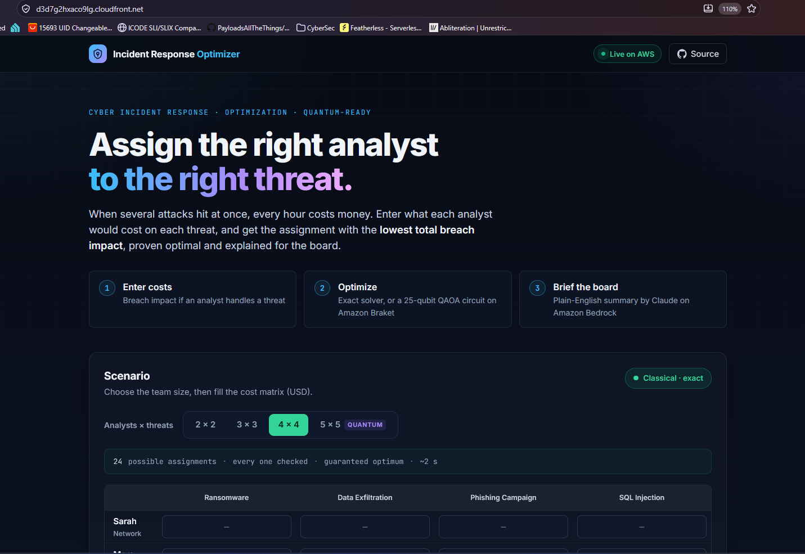</p>

**Step 2: enter the costs.** Pick the team size and type (or load) the cost of each analyst on each threat. Cells turn green for cheap and red for expensive, so you can read the table at a glance.

<p align="center"></p>

**Step 3: get the answer.** For small teams (up to 4×4) the system checks *every* possible assignment, so the answer is guaranteed to be the cheapest. It returns in about 2 seconds with:

- the **total exposure** of the best assignment,
- what the **greedy** approach would have cost and **how much is saved**,
- who handles what,
- a **board summary** written by AI.

<p align="center"></p>

**Step 4: the quantum version.** Selecting 5×5 switches the system to quantum mode: the purple badge shows that a 25-qubit quantum program will be sent to Amazon Braket.

<p align="center"></p>

The quantum job runs in the background for about 45 seconds while the page shows its progress:

<p align="center"></p>

When it finishes, the result shows the proven best assignment ($209,000) **and** a report on how the quantum circuit performed (explained in the next section):

<p align="center"></p>

---

## 3. Quantum computing, explained from zero

### Bits and qubits

A normal computer stores information in **bits**. A bit is a switch that is either 0 or 1.

A quantum computer uses **qubits**. Before you look at a qubit, it can be in a blend of 0 and 1 at the same time, called a **superposition**. Each possibility carries a weight (an *amplitude*) that decides how likely it is to show up. When you **measure** the qubit, the blend disappears and you get a plain 0 or 1, at random, with those likelihoods.

Twenty-five qubits together can be in a blend of all 2²⁵ ≈ **33.5 million** combinations of zeros and ones at once.

### The common myth, and what really happens

You often hear "a quantum computer tries every answer at once". That isn't quite right: when you measure, you only get **one** answer, at random. If all 33.5 million combinations were equally likely, you would just get random noise.

The real trick is **interference**. Amplitudes behave like waves: they can add up (making an answer more likely) or cancel out (making it less likely). A quantum algorithm is a carefully designed sequence of operations that makes the amplitudes of **good answers grow** and those of **bad answers shrink**. Then you measure many times (each measurement is called a **shot**) and look at which answers come up most often.

### Turning "who handles what" into qubits

Picture a 5×5 grid of light bulbs, one per (analyst, threat) pair. Each bulb is a qubit:

```
              Ransomware  Data theft  Phishing  SQL inj.  DDoS
  Sarah           0           0          0         1        0      ← Sarah on SQL injection
  Marc            0           1          0         0        0
  David           1           0          0         0        0
  Lisa            0           0          1         0        0
  Chen            0           0          0         0        1
```

A bulb that is **on (1)** means "this analyst takes this threat". A grid is a **valid** plan only if every row and every column has exactly one bulb on (each analyst does one thing, each threat gets one analyst).

To tell the quantum computer what "good" means, the problem is written as a cost to minimize, called a **QUBO** (Quadratic Unconstrained Binary Optimization):

- every bulb that is on adds its dollar cost, and
- every broken rule (two bulbs in one row, an empty column, and so on) adds a **penalty**, a fake cost big enough that breaking rules is never worth it.

The cheapest grid under this scoring is exactly the best valid plan. A test in this project checks that for every one of the 2⁹ = 512 possible 3×3 grids.

### What QAOA does

**QAOA** (Quantum Approximate Optimization Algorithm) is a well-known recipe for this kind of problem. It repeats two steps:

1. **The cost step** marks every possible grid according to how expensive it is (it shifts the "wave" of each answer by an amount tied to its cost).
2. **The mixing step** lets probability flow between neighbouring grids, so the marks from step 1 turn into interference that favours cheap grids.

Repeating both steps 16 times, while slowly shifting the balance from "explore" to "settle", gently steers the 25 qubits toward low-cost plans. It is similar to slowly cooling molten metal so it settles into a strong, low-energy structure. That is why this schedule is called a **linear ramp**: its settings change a little at each of the 16 rounds.

The whole program is 5,625 elementary quantum operations (*gates*), written in a standard quantum language called **OpenQASM**.

### Simulator or real quantum computer?

The program runs on **Amazon Braket SV1**, a *simulator*: a large classical computer that calculates exactly what a perfect, noise-free quantum computer would do. Tracking 25 qubits means tracking 33.5 million numbers, which is feasible. Beyond roughly 40-50 qubits, simulation becomes impossible, and that is where real quantum hardware is needed. Today's real quantum chips are still noisy, and this circuit is too long for them (see [limitations](#9-honest-limitations-and-what-comes-next)).

### How well did it do? Reading the results panel

From the live run shown above (1,000 shots):

| What was measured | Result | What it means |
|---|---|---|
| Valid plans | **40.3%** of shots | About 4 shots in 10 were a grid that follows all the rules. Random bulbs would almost never do that |
| Optimal plan | **4.3%** of shots | 43 shots landed exactly on the best plan. A random guess of 25 bulbs would hit it about **once in 33.5 million tries** |
| Best plan seen | **$209,000** | The best valid plan the quantum circuit produced **was the true optimum** |
| Among valid plans only | **10.7% optimal** vs **0.8% by chance** | Even compared fairly with picking a random *valid* plan, the circuit chose the best one **13× more often** |

In every simulated test of this configuration, the optimum appeared among the 1,000 shots (details in [QAOA performance](#qaoa-performance)).

### Then why check the answer classically?

Because QAOA is *approximate*: it makes good answers likely, not certain. With 5 analysts, checking all 120 possibilities takes microseconds, so the system always **verifies** the quantum result and returns the proven best plan. This "hybrid" approach (quantum explores, classical verifies) is how serious quantum work is done today. It also lets the system report the quantum circuit's quality honestly, instead of hiding it.

> **Bottom line:** for this problem, a normal computer is faster. The value of this project is a complete, tested pipeline (business problem → quantum formulation → cloud quantum service → verified result) that works today and is ready for harder problems and better hardware.

---

## 4. The AI part: a summary for the board

Executives don't want cost matrices. After each optimization, the system asks **Claude**, an AI model by Anthropic, through **Amazon Bedrock** (AWS's service for AI models), to write a three-sentence summary like:

> *"The security operations team assigned Sarah to the Phishing Campaign, Marc to Data Exfiltration, and David to Ransomware, achieving a total breach impact cost of $185,000. This assignment is mathematically proven optimal because all six possible assignments were evaluated exhaustively; it outperforms the greedy algorithm by $29,000…"*

AI can make things up, so it is kept on a short leash:

- It receives **only the computed figures** and is instructed to use nothing else.
- It is told **never to claim a quantum advantage**: no hype.
- Analyst and threat names typed by users are checked and clearly marked as data, so they can't be used to slip instructions to the AI (an attack called *prompt injection*).
- If the AI service is unavailable, a pre-written template summary is used instead, so a result is never lost.

---

## 5. The cloud part: how it runs on AWS

**AWS (Amazon Web Services)** rents computing services by the second. Instead of owning servers, this project assembles managed services, each doing one job. It is **serverless**: nothing runs (or costs money) while nobody is using it.

### The pieces, in plain words

| AWS service | In plain words | Its job in this project |
|---|---|---|
| **CloudFront** | A worldwide delivery network | Serves the website quickly and securely over HTTPS |
| **S3** | File storage | Holds the website files, and the raw quantum results |
| **API Gateway** | The front door | Receives requests from the browser, enforces rate limits |
| **Lambda** | Small programs that run on demand | Four of them: the router, the classical solver, the quantum handler, the status checker |
| **DynamoDB** | A fast database | Remembers every job and its result for 7 days |
| **Braket** | AWS's quantum computing service | Runs the 25-qubit circuit on the SV1 simulator |
| **EventBridge** | A notification system | Says "the quantum job is finished" so the result can be processed |
| **Bedrock** | AWS's AI model service | Runs Claude for the board summary |
| **CloudWatch + SNS** | Monitoring cameras and an alarm bell | Graphs, logs and email alerts if anything fails |
| **IAM** | Badges and keys | Decides exactly what each piece is allowed to do |

### Following one request, step by step

**Small team (instant):** the browser sends the costs → API Gateway checks the rate limit → the *router* Lambda validates the data → the *classical* Lambda checks every assignment and asks Claude for a summary → the result is saved in DynamoDB and sent back. About 2 seconds.

**5×5 team (quantum, asynchronous):** a quantum job takes about 45 seconds, too long to keep a web request waiting. So the system works like a **restaurant buzzer**:

1. You place your order: the browser sends the costs.
2. You get a ticket number: the router saves a "pending" job in DynamoDB and immediately returns a **job ID**.
3. The kitchen cooks: the *quantum* Lambda sends the circuit to Braket.
4. The buzzer rings: when Braket finishes, **EventBridge** wakes the quantum Lambda up again. It reads the 1,000 measurements, computes the quality metrics, verifies the optimum, asks Claude for a summary and marks the job "complete".
5. You pick up your order: meanwhile the browser asks every 4 seconds "is job X ready?", and shows the result as soon as it is.

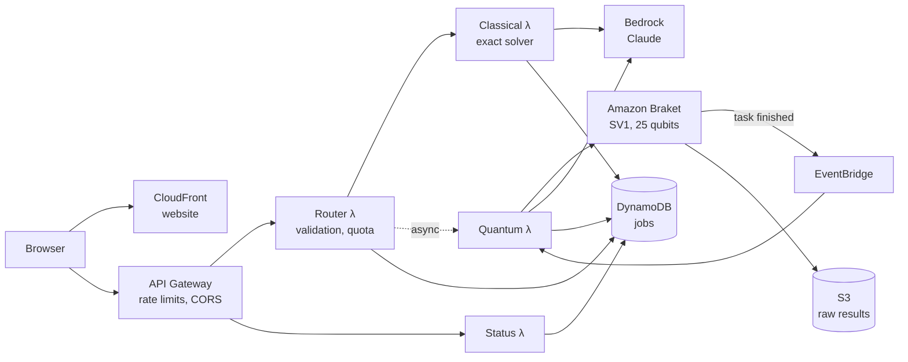

### Infrastructure as Code

Nothing was clicked together by hand. The whole environment (about 60 resources) is described in **Terraform** files, a blueprint that AWS builds automatically. One command creates everything, one command deletes everything, and the exact same setup can be rebuilt in any account. That is what makes the project reproducible ([SETUP.md](SETUP.md)).

---

## 6. Security: how the system protects itself

This is a public website that triggers paid services (quantum time, AI calls), so it was designed like a production system. Each protection answers a concrete threat:

| Threat | Protection |
|---|---|
| Someone floods the site to run up the AWS bill ("denial of wallet") | Rate limits on the API, and a **daily cap of 50 quantum jobs** |
| A component gets compromised and is used to reach other data | **Least privilege**: each Lambda has its own identity that can only do its exact job |
| Someone reads or tampers with the website files | Files are in a **private** bucket that only CloudFront can read; HTTPS everywhere |
| Malicious input (scripts, absurd numbers, huge payloads) | Strict validation of every field before anything else runs |
| Malicious scripts injected into the web page (XSS) | All displayed data is escaped, plus a strict **Content-Security-Policy** that blocks any script not served by the site |
| Tricking the AI with crafted names (prompt injection) | Names are validated and marked as data; the AI only sees computed figures |
| Failures going unnoticed | Five alarms that email the owner on any error |

### What that looks like in AWS

**Least privilege.** The status-checker Lambda is allowed exactly two things: write its own logs, and *read* one item from one table (`dynamodb:GetItem`). Even if it were compromised, it could not change data, call the AI or start quantum jobs.

<p align="center">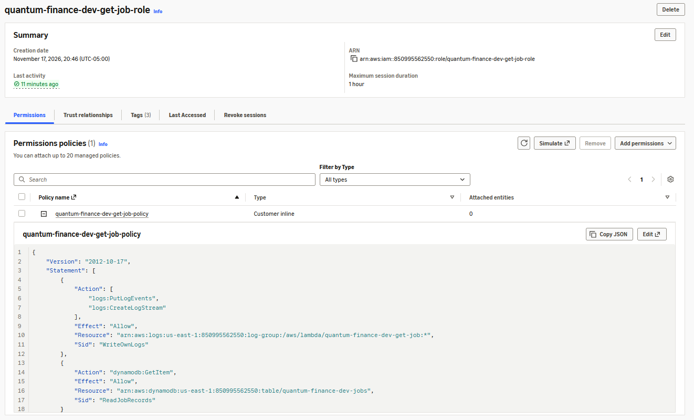</p>

**Rate limits.** The endpoint that starts optimizations accepts at most 1 request per second (bursts of 5); the rest of the API allows 10 per second.

<p align="center">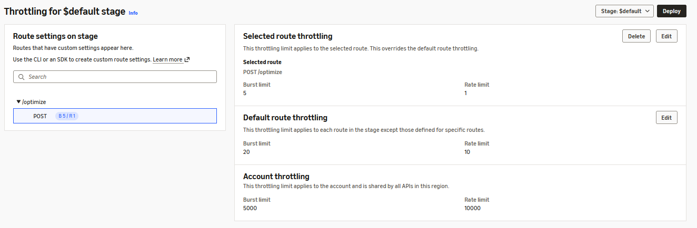</p>

**A private website bucket.** "Block all public access" is on, and the bucket policy allows reading only by the CloudFront service, and only for this project's distribution.

<p align="center">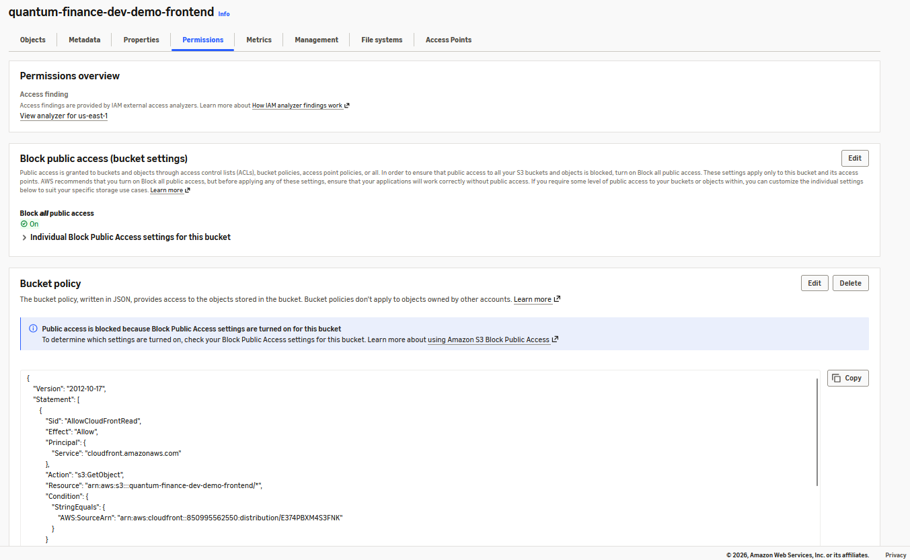</p>

**Alarms.** Every Lambda and the API have an alarm that emails the owner within 5 minutes of an error. All are green:

<p align="center">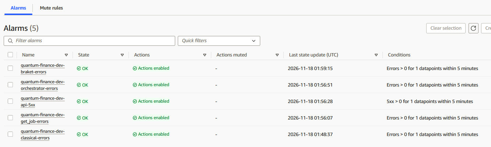</p>

---

## 7. Proof it really runs

These screenshots come from the live deployment (account identifiers redacted).

**The quantum jobs on Amazon Braket.** Each 5×5 optimization created a real quantum task on the SV1 simulator; all completed:

<p align="center">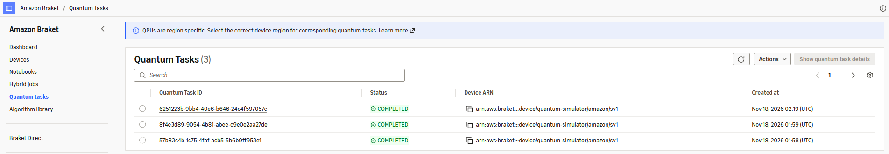</p>

**One quantum task in detail.** 1,000 of 1,000 shots succeeded, and the task is tagged with the job it belongs to. That tag is how the system finds the right job when Braket reports back.

<p align="center">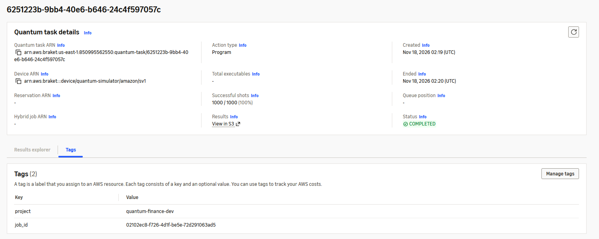</p>

**The job records in DynamoDB.** One row per optimization (quantum ones carry their Braket task), plus the daily quota counter (`quota#2026-11-18`):

<p align="center">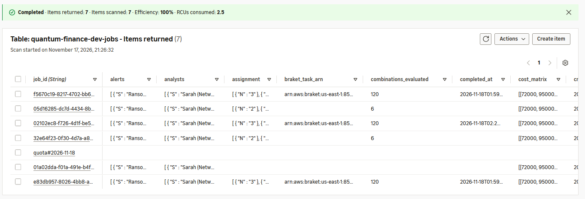</p>

**The monitoring dashboard.** Activity from the test session. The small error spike at 01:50 is a real bug caught during redeployment (the shared code package was laid out incorrectly, see [challenge #25](#engineering-challenges-solved)), fixed within minutes. There have been no errors since.

<p align="center">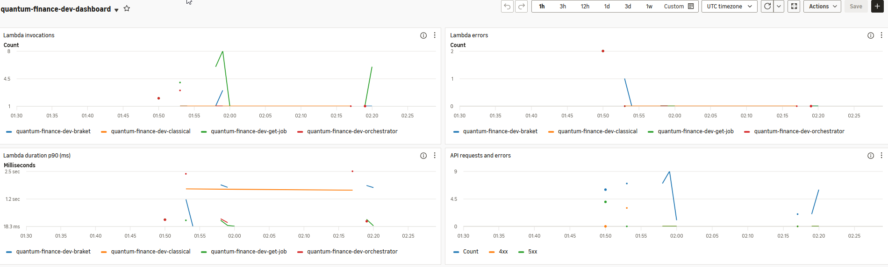</p>

---

## 8. How the code is built and tested

- **48 automated tests** run on every change (GitHub Actions). They cover the quantum math, the full quantum workflow with simulated AWS services, input validation and the AI fallback.
- The most important test **simulates the exact quantum program sent to Braket**, gate by gate, with a small simulator written for this project, and checks it matches the theory. Bugs are caught before spending money on cloud quantum time.
- A **benchmark script** reproduces every quantum number in this README on a laptop.
- **Terraform** checks (`fmt`, `validate`) run on every change too.

---

## 9. Honest limitations and what comes next

**Limitations**
- **No quantum speed-up.** A normal computer solves this problem faster at every size. The quantum path is a working, measured pipeline, not a performance claim.
- **Simulator, not hardware.** Real quantum chips are noisy; with about 3,200 two-qubit operations, this circuit is too long for them today.
- **Demo-level access.** The site is public and protected by rate limits and a quota, not by logins.

**Next steps**
- Run on **real quantum hardware**, with a shorter circuit designed for it (a constraint-preserving "XY mixer") and error mitigation.
- **Variational tuning** (letting a classical optimizer tune the circuit) with Amazon Braket Hybrid Jobs, compared with the fixed schedule.
- **Larger teams** classically, with the Hungarian algorithm.
- **Logins** (Amazon Cognito) and a web application firewall (AWS WAF) for real-world use.
- **Harder variants** (analysts on several incidents, skills, deadlines), where no shortcut algorithm exists and the quantum approach actually matters.

---

## Technical deep dive

<details open>
<summary><b>Contents</b></summary>

- [Request flow (sequence)](#request-flow)
- [QAOA formulation](#qaoa-formulation)
- [QAOA performance](#qaoa-performance)
- [Security controls (detailed)](#security-controls-detailed)
- [Infrastructure and design decisions](#infrastructure-and-design-decisions)
- [Testing](#testing)
- [API reference](#api-reference)
- [Engineering challenges solved](#engineering-challenges-solved)

</details>

### Request flow

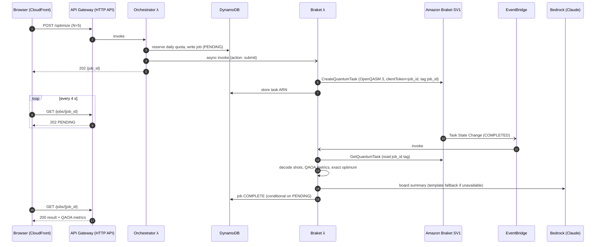

| | Classical (N ≤ 4) | Quantum (N = 5) |
|---|---|---|
| Method | Enumerate all N! permutations (≤ 24) | QAOA, 25 qubits, p = 16, 5,625 gates, 1,000 shots on SV1 |
| Response | Synchronous `200` (~2.5 s incl. Bedrock) | `202` + `job_id`, then poll (~45 s; SV1 task 20-30 s) |
| Result | Proven optimum + greedy baseline + summary | Same + QAOA quality metrics |

### QAOA formulation

All quantum logic is in [`modules/lambda_braket/src/qaoa.py`](modules/lambda_braket/src/qaoa.py) (pure Python, no dependencies).

**QUBO.** One binary variable `x_ij` per (analyst *i*, threat *j*), qubit `k = i·N + j`:

```
E(x) = Σ c'_ij x_ij                 cost, normalised to [0, 1]
     + A Σ_i (Σ_j x_ij − 1)²        one threat per analyst
     + A Σ_j (Σ_i x_ij − 1)²        one analyst per threat
```

Dropping one assignment from a valid permutation saves at most `c'_max = 1` but breaks a row and a column (+2A), so any `A > 0.5` keeps valid assignments energetically preferred; `A = 0.75`.

**Ising.** `x = (1 − z)/2` gives `H_C = Σ h_k Z_k + Σ J_kl Z_k Z_l`, rescaled so `max |coefficient| = 1` (schedule independent of N and dollar scale).

**Circuit.** OpenQASM 3 with Braket's built-in gate names (no `include`), one qubit register, one bit register, every qubit measured, per SV1's `GetDevice` capabilities:

```
|+⟩^⊗25  ──►  for i = 1..p:  e^{−iγᵢ H_C} · e^{−iβᵢ H_M}  ──►  measure (1,000 shots)

  e^{−iγ h Z_k}         →  rz(2γh) q[k]
  e^{−iγ J Z_k Z_l}     →  cnot q[k], q[l]; rz(2γJ) q[l]; cnot q[k], q[l]   (100 pairs per layer)
  e^{−iβ H_M}, H_M=−ΣX  →  rx(−2β) q[k]
```

**Schedule.** Linear ramp (Montañez-Barrera & Michielsen, *Towards a universal QAOA protocol*, 2024): `γᵢ = Δγ·tᵢ`, `βᵢ = Δβ·(1 − tᵢ)`, `tᵢ = (i − ½)/p`, with Δγ = 3.2, Δβ = 0.6, A = 0.75, p = 16, tuned offline with the statevector simulator. No variational loop, because each optimizer step would be a separately billed task.

**Decoding.** A bitstring is valid iff each row and column contains exactly one `1`. The handler reports the best valid sample, valid and optimal shot fractions, and the gap to the exact optimum. Invalid samples are never repaired.

### QAOA performance

Noiseless statevector simulation of the exact circuit (`python tests/benchmark_qaoa.py`), random cost matrices ($10k-$120k), 1,000 sampled shots:

| N | Qubits | Instances | P(valid) per shot | P(optimal) per shot | Random-guess P(optimal) | Best sample = optimum |
|---|--------|-----------|-------------------|---------------------|-------------------------|-----------------------|
| 3 | 9      | 20        | 0.665             | 0.323               | 2.0 × 10⁻³              | 20 / 20               |
| 4 | 16     | 20        | 0.710             | 0.139               | 1.5 × 10⁻⁵              | 20 / 20               |
| 5 | 25     | 5         | 0.433             | 0.049               | 3.0 × 10⁻⁸              | 5 / 5                 |

Live SV1 runs on the README example matrix (simulator prediction: 0.395 valid, 0.0385 optimal per shot): **0.346 / 0.033**, **0.398 / 0.049** and **0.403 / 0.043**, optimum found every time. Expected ranges are in [SETUP.md](SETUP.md#53-quantum-path-5x5-on-amazon-braket).

> **History:** the first version used a fixed 1-3 layer circuit with an incomplete constraint encoding and always returned the brute-force answer; its QAOA gaps were 33-112%.

### Security controls (detailed)

| Layer | Control |
|---|---|
| **Frontend** | Private S3 behind CloudFront with **Origin Access Control**; HTTPS only; HSTS, `X-Frame-Options: DENY`, `nosniff`; **CSP** `default-src 'none'; script-src 'self'` (no inline script or style attributes; dynamic styles set via CSSOM); all API data HTML-escaped |
| **API Gateway** | Throttling 10 rps / 20 burst; `POST /optimize` 1 rps / 5 burst; **CORS** restricted to the CloudFront origin; JSON access logs |
| **Orchestrator** | Validation (size, types, finite non-negative costs ≤ 10⁹, label allow-list, 16 KB body); atomic **daily quantum quota** in DynamoDB (`429`) |
| **IAM** | One role per Lambda; statements scoped to the table, bucket, the two invokable functions, the function's own log group and the configured Bedrock model / inference profile. `braket:CreateQuantumTask` requires `*` |
| **Invocation** | Lambda permissions restricted to the API's routes and the EventBridge rule; Braket events from other projects ignored (tag check) |
| **Data** | Encryption at rest; S3 TLS-only policies, ACLs disabled; results expire after 30 days, job records after 7 (TTL) |
| **AI** | Inputs validated, wrapped in `<data>` and declared non-instructions in the system prompt; output rendered as text |
| **Monitoring** | Error alarms on all four Lambdas and API 5xx → SNS email |

### Infrastructure and design decisions

```
rootTerraformCode/          root module, variables, outputs, state moves
modules/
├── storage/                DynamoDB jobs table, Braket results bucket
├── iam/                    4 least-privilege execution roles
├── shared_layer/           Lambda layer: layer/python/qf_common (solver, Bedrock, job records, HTTP)
├── lambda_orchestrator/    POST /optimize: validation, quota, routing
├── lambda_classical/       exact solver + greedy baseline + summary
├── lambda_braket/          QAOA submit + completion (qaoa.py)
├── lambda_get_job/         GET /jobs/{job_id}
├── messaging/              EventBridge: Braket task state change → Lambda
├── api_gateway/            HTTP API, throttling, CORS, access logs
├── demo_frontend/          private S3 + CloudFront + security headers; site/ is static
└── observability/          SNS, alarms, dashboard
```

| Decision | Rationale |
|---|---|
| Orchestrator writes `PENDING` **before** dispatching | An accepted job can never 404, even if a later step fails |
| `clientToken = job_id` on `CreateQuantumTask` | Retries cannot create duplicate billed tasks |
| Job ID carried as a **Braket task tag** | Completion handler resolves its job from the task: no race, no secondary index, foreign tasks ignored |
| State transitions conditional on `status = PENDING` | Duplicate events and retries are harmless |
| Errors mark the job `FAILED`, then re-raise | The user sees a clear failure *and* the alarm fires |
| Bedrock summary has a deterministic fallback | An AI outage never loses a result; `narrative_source` says which was used |
| OpenQASM 3, Braket gate names, no `include` | The only format SV1 accepts; checked by a test that parses and simulates the exact source |
| Linear-ramp QAOA instead of a variational loop | Each optimizer step would be a separate billed task |
| Shared code as a **Lambda layer**; arm64; pure Python | Defined once; cheaper, faster cold starts; nothing to compile |
| Log groups created before functions; `moved` blocks | Retention from the first invocation; safe migration of existing deployments |

### Testing

```bash
pip install -r requirements-dev.txt
pytest                                               # 48 tests, ~1 s
python tests/benchmark_qaoa.py                       # performance table, N = 3 and 4
python tests/benchmark_qaoa.py --n 5 --instances 5   # 25 qubits, ~3 min per instance
```

| Suite | What it proves |
|---|---|
| `test_qaoa.py` | QUBO ground state = optimal assignment; Ising ≡ QUBO up to a constant; **the exact OpenQASM program, parsed and simulated gate by gate, equals the reference QAOA evolution**; SV1 program rules; the optimum is the most likely outcome; decoding and metrics |
| `test_handlers.py` | End-to-end quantum flow with in-memory AWS fakes: 202 → idempotent submit → completion (duplicate ignored) → 200; failed and foreign tasks; daily quota; ID validation |
| `test_validation.py` | Malformed, oversized, non-finite, duplicate and injection-style inputs rejected |
| `test_common.py` | README example values, Bedrock fallback paths, serialization, Lambda layer layout |

### API reference

<details>
<summary><b><code>POST /optimize</code></b></summary>

```json
{
  "analysts":    ["Sarah", "Marc", "David", "Lisa", "Chen"],
  "alerts":      ["Ransomware", "Data Exfiltration", "Phishing", "SQL Injection", "DDoS"],
  "cost_matrix": [
    [72000,  95000,  98000,  75000,  37000],
    [112000, 31000,  67000,  99000,  49000],
    [56000,  65000, 111000, 106000,  34000],
    [61000, 120000,  28000,  77000, 115000],
    [107000, 101000, 10000,  81000,  19000]
  ]
}
```

Rules: 2 ≤ N ≤ 5; all fields size N (×N); names unique, 1-60 characters (letters, digits, spaces, `. , ' ( ) & / + -`); costs 0 to 1,000,000,000.

| Status | Meaning |
|---|---|
| `200` | N ≤ 4: completed classical result |
| `202` | N = 5: quantum job accepted; poll `GET /jobs/{job_id}` |
| `400` | Validation error `{"error": "..."}` |
| `429` | Rate limit or daily quantum quota reached |
| `502` | A downstream solver could not be reached |

Classical `200` (top-left 3×3 of the example):
```json
{
  "job_id": "uuid", "status": "COMPLETE", "method": "CLASSICAL",
  "assignment": [
    {"analyst": "Sarah", "alert": "Phishing", "cost": 98000},
    {"analyst": "Marc", "alert": "Data Exfiltration", "cost": 31000},
    {"analyst": "David", "alert": "Ransomware", "cost": 56000}
  ],
  "total_cost": 185000, "greedy_cost": 214000, "savings": 29000,
  "combinations_evaluated": 6,
  "narrative": "Three-sentence board summary...", "narrative_source": "bedrock"
}
```
</details>

<details>
<summary><b><code>GET /jobs/{job_id}</code></b></summary>

| Status | Body |
|---|---|
| `202` | `{"status": "PENDING", "message": "..."}` |
| `200` | `COMPLETE` result, or `{"status": "FAILED", "error": "..."}` |
| `400` / `404` | Not a UUID / unknown or expired job |

A completed quantum job adds:

```json
"qaoa": {
  "qubits": 25, "layers": 16, "shots": 1000,
  "feasible_fraction": 0.403, "optimal_fraction": 0.043,
  "qaoa_assignment": [{"analyst": "Sarah", "alert": "SQL Injection", "cost": 75000}],
  "qaoa_cost": 209000, "qaoa_gap_pct": 0, "qaoa_found_optimum": true,
  "distinct_bitstrings": 505, "random_baseline_optimal_fraction": 0.0083
}
```
</details>

### Engineering challenges solved

<details>
<summary><b>Braket and Bedrock integration (9 issues)</b></summary>

| # | Issue | Root cause | Fix |
|---|---|---|---|
| 1 | `ValidationException: include statements not supported` | OpenQASM `include "stdgates.inc"` rejected by SV1 | Moved to JAQCD (later back to OpenQASM without `include`, see #24) |
| 2 | `ValidationException: cx gate not supported` | `cx` comes from `stdgates.inc`; Braket's built-in name is `cnot` | Braket gate names (`cnot`, `rz`, `rx`, `h`) |
| 3 | `Provided action is not valid` | JAQCD gates used `"gate"`; the field is `"type"` | Verified against `amazon-braket-schemas-python` |
| 4 | `results field invalid` | Measurement is implicit in JAQCD | `results: []` |
| 5 | `paradigmParameters is missing` | `CreateQuantumTask` needs `deviceParameters` | Simulator device parameters with `qubitCount` |
| 6 | `bucket must start with 'amazon-braket-'` | Braket naming rule | Bucket renamed |
| 7 | `ResourceNotFoundException` on `InvokeModel` | Anthropic models need a use-case form on new accounts | Form submitted; `us.` inference profile |
| 8 | `JSONDecodeError` after async invoke | `InvocationType="Event"` returns no payload | Removed the payload read |
| 9 | `qubitCount must be between 1 and 34` | N = 6 needs 36 qubits | Max N = 5 |

</details>

<details>
<summary><b>Infrastructure (5 issues)</b></summary>

| # | Issue | Fix |
|---|---|---|
| 10 | Dashboard `region required` | `region` on every widget |
| 11 | Output referenced a non-existent EventBridge resource | Fixed reference |
| 12 | Completion handler scanned the table to find its job | GSI first, then a Braket task tag (no index, no race) |
| 13 | `templatefile()` broke on JavaScript `${...}` | Static site files plus a generated `config.js` |
| 14 | `AWSServiceRoleForAmazonBraket` missing | One-time step (`aws iam create-service-linked-role`) |

</details>

<details>
<summary><b>Second iteration: hardening review and redeployment (11 findings)</b></summary>

| # | Finding | Fix |
|---|---|---|
| 15 | QAOA penalty missing linear terms; fixed angles | Full QUBO → Ising derivation, tuned schedule, tests + simulation |
| 16 | Quantum result discarded; invalid samples repaired greedily | Best valid sample reported with valid/optimal shot rates |
| 17 | AI summary claimed superposition "evaluated every configuration" | Prompts limited to supplied figures; no advantage claims |
| 18 | Public API could trigger unlimited paid calls | Throttling, daily quota, CORS lock-down |
| 19 | Jobs could stay `PENDING` forever | PENDING written first, failures mark `FAILED`, AI fallback |
| 20 | Retries could duplicate quantum tasks | `clientToken` + conditional transitions |
| 21 | Shared IAM role with wildcard resources | One scoped role per function |
| 22 | `innerHTML` with API data; public HTTP bucket | Escaping, CSP, CloudFront + OAC |
| 23 | No tests | 48 tests, CI, benchmark |
| 24 | Redeploy: `Device ... sv1 supports ['braket.ir.openqasm.program'] ..., but the supplied action type is braket.ir.jaqcd.program` | SV1 dropped JAQCD. Queried `GetDevice` capabilities and re-emitted the same circuit as OpenQASM 3 within SV1's rules; the test now simulates the exact OpenQASM text |
| 25 | Redeploy: `Runtime.ImportModuleError: No module named 'qf_common'` | `archive_file` zips the *contents* of `source_dir`, so the layer lacked the `python/` prefix Lambda requires. Moved code to `layer/python/`; added a layout test |

</details>

---

## Run it yourself

```bash
git clone https://github.com/Xav519/aws-quantum-finance-AI.git
cd aws-quantum-finance-AI/rootTerraformCode
cp terraform.tfvars.example terraform.tfvars   # add your email and a unique project prefix
terraform init && terraform apply
```

**[SETUP.md](SETUP.md)** walks through everything: AWS account preparation (Braket, Bedrock access), deployment, the exact inputs and expected outputs to reproduce these results, costs (a test session is well under $1), troubleshooting and teardown.

---

## Glossary

| Term | Meaning |
|---|---|
| **Amplitude** | The "weight" of one possible outcome in a quantum superposition; it decides how likely that outcome is when measured |
| **Assignment problem** | Matching N people to N tasks, one each, at the lowest total cost |
| **Asynchronous** | Work that finishes later; the caller gets a ticket (job ID) and checks back |
| **CSP (Content-Security-Policy)** | A browser rule that blocks any script the site didn't explicitly allow |
| **Greedy algorithm** | Making the best-looking choice at each step without considering the whole picture |
| **Hungarian algorithm** | A classical method that solves the assignment problem efficiently, even for large N |
| **Interference** | Amplitudes adding up or cancelling out, which is how quantum algorithms favour good answers |
| **Least privilege** | Giving each component only the permissions it strictly needs |
| **N! (factorial)** | 1 × 2 × … × N, the number of ways to assign N analysts to N threats |
| **OpenQASM** | A standard text language for writing quantum programs |
| **QAOA** | Quantum Approximate Optimization Algorithm: alternates cost and mixing steps to steer qubits toward cheap answers |
| **Qubit** | A quantum bit, which can be in a superposition of 0 and 1 until measured |
| **QUBO** | A way of writing an optimization problem as a cost over 0/1 variables, with rule-breaking turned into penalties |
| **Serverless** | Cloud code that runs only when needed, with no servers to manage |
| **Shot** | One run-and-measure of a quantum circuit; many shots give a statistical picture |
| **Simulator (SV1)** | A classical computer that computes exactly what an ideal quantum computer would do |
| **Superposition** | A qubit's state of being a blend of 0 and 1 before measurement |
| **Terraform** | A tool that builds cloud infrastructure from text files (Infrastructure as Code) |

---

## About

**Xavier Dupuis**
Cybersecurity Advisor - Banque Nationale du Canada
B.Eng. Cybersecurity Engineering - École Polytechnique de Montréal (Graduating 2026)

**Certifications:** AWS Certified Security Specialty · AWS Solutions Architect Associate · AWS Cloud Practitioner · CompTIA Security+ · CompTIA Network+

<p align="center">
  <b>Let's build something secure.</b><br>
  <a href="https://www.linkedin.com/in/xavierdupuis/">LinkedIn</a>
</p>
